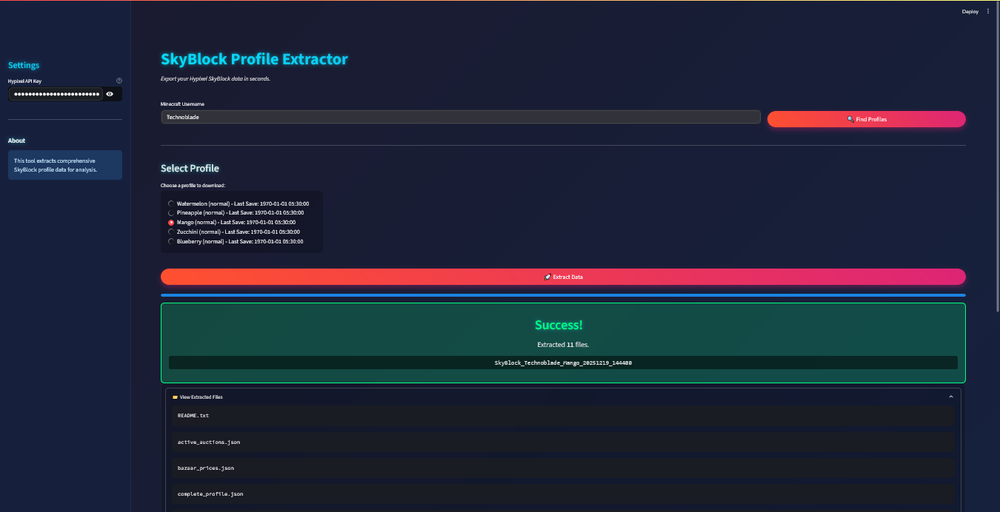

# SkyBlock Profile Extractor

<p align="center">
  
</p>

[](https://www.python.org/)
[](LICENSE)
[](https://developer.hypixel.net/)
[](#automated-testing)

An open-source, on-demand data extraction utility and progression analyzer for Hypixel SkyBlock. Designed for personal character backups, progression tracking, and structured dataset export via the official Hypixel API v2.

<p align="center">
  
</p>

---

## Overview

SkyBlock Profile Extractor allows Minecraft players to query their own character data, inventory states, and progression metrics. Data is serialized into organized JSON files with SHA-256 integrity checksums.

The utility provides:
- **Streamlit Web Application (`app.py`)**: An interactive, minimal graphical interface featuring real-time progress indicators and in-browser ZIP downloads.
- **Python CLI Tool (`extract_profile.py`)**: A command-line script for automated or non-interactive backups.
- **Windows PowerShell Utility (`extract-profile.ps1`)**: A native script with TLS 1.2 support and request throttling.
- **Progression Analytics Engine (`analysis.py`)**: Computes skill averages, catacombs levels, slayer ranks, and explainable next-step recommendations.

> **Disclaimer**: This project is an independent open-source utility and is not affiliated with, endorsed by, or associated with Hypixel Inc. or Mojang AB.

---

## Verified Capabilities

| Category | Extracted Datasets | Output Filename |
| :--- | :--- | :--- |
| **Complete Profile** | Inventories, Skills, Slayers, Dungeons, Collections, Wardrobe, Vault | `complete_profile.json` |
| **Progression Summary** | Skill averages, Catacombs milestones, Slayer boss tiers, explainable recommendations | `profile_summary.json` |
| **Integrity Manifest** | SHA-256 file hashes, endpoint status mapping, extraction metadata | `extraction_manifest.json` |
| **Garden Data** | Garden level, plot unlock status, crop milestones, visitor count | `garden_data.json` |
| **Museum Data** | Donated items, museum appraisals, special collectibles | `museum_data.json` |
| **Guild Data** | Guild roster, rank tiers, guild experience | `guild_data.json` |
| **Economy Snapshot** | Live Bazaar buy/sell orders and active profile auction house listings | `bazaar_prices.json`, `active_auctions.json` |
| **Player Activity** | Base achievements, network level, online status, recent minigame sessions | `player_data.json`, `online_status.json`, `recent_games.json` |
| **Community Events** | In-game announcements, fire sales, and active bingo objectives | `skyblock_news.json`, `fire_sales.json`, `bingo_data.json` |

---

## Prerequisites

1. **Python 3.8+** (for Web GUI and Python CLI)
2. **Hypixel API Key**: Generate a Personal or Development key at the [Hypixel Developer Dashboard](https://developer.hypixel.net/).
3. **In-game API Permissions**: Enable API access in Hypixel via `SkyBlock Menu` -> `Settings` -> `API Settings` (Skills, Inventory, Collections, Banking).

---

## Installation

Clone the repository and install the dependencies:

```bash
# Clone the repository
git clone https://github.com/sizwinz/Hypixel-SkyBlock-Profile-Extractor.git
cd Hypixel-SkyBlock-Profile-Extractor

# Create and activate a virtual environment
python -m venv .venv
# Windows:
.venv\Scripts\activate
# Linux/macOS:
source .venv/bin/activate

# Install production dependencies
pip install -r requirements.txt

# (Optional) Install development and testing dependencies
pip install -r requirements-dev.txt
```

---

## Usage

### 1. Web Graphical Interface (Recommended)

Launch the Streamlit web dashboard:

```bash
streamlit run app.py
```

Workflow:
1. Provide your Hypixel API key in the sidebar.
2. Enter your Minecraft username and click **Find Profiles**.
3. Select your target SkyBlock profile (e.g. Tomato, Apple, Ironman).
4. Choose the categories to export.
5. Click **Start Extraction**. Monitor real-time progress.
6. Review calculated metrics and click **Download Archive** to download a complete ZIP package directly through your browser.

### 2. Python Command-Line Interface

Run extraction directly from your terminal:

```bash
# Interactive mode
python extract_profile.py

# Specify username and profile
python extract_profile.py Technoblade -p Tomato

# Non-interactive silent execution (requires HYPIXEL_API_KEY environment variable or api_key.txt)
python extract_profile.py Technoblade -s --zip

# Custom output directory
python extract_profile.py Technoblade --output-dir ./my_exports --zip
```

CLI flags:
- `username`: Target Minecraft username.
- `-p, --profile`: Target profile cute name (case-insensitive).
- `-s, --silent`: Non-interactive mode (auto-selects most recent profile).
- `--api-key`: Explicit Hypixel API key string.
- `--output-dir`: Custom directory path for export.
- `--zip`: Generate a compressed ZIP archive alongside the directory.

### 3. Windows PowerShell Utility

For environments without Python installed:

```powershell
# Interactive execution
.\extract-profile.ps1

# Non-interactive execution
.\extract-profile.ps1 -Username "Technoblade" -Profile "Tomato" -Silent
```

---

## Credential Security & Policy Compliance

- **Header Authentication**: All authenticated requests pass the key via the official `API-Key` HTTP header. URL query parameters (`?key=...`) are not used.
- **Environment Support**: Set the `HYPIXEL_API_KEY` environment variable to authenticate without storing credentials on disk.
- **Git Exclusions**: `api_key.txt` and `.env` are explicitly excluded in `.gitignore`. Credentials are never committed.
- **Automatic Redaction**: `api_client.py` strips API keys from exception messages, representation strings, and logs.
- **No Continuous Tracking**: Extractions are initiated solely on demand by user command. The project maintains no background monitoring services.

For detailed policy documentation, refer to [docs/API_USAGE.md](docs/API_USAGE.md).

---

## Project Repository Structure

```text
Hypixel-SkyBlock-Profile-Extractor/
├── .github/
│   └── workflows/
│       └── tests.yml          # Automated CI testing matrix
├── assets/                    # Project visual branding and screenshots
│   ├── logo.png
│   └── Screenshot.png
├── docs/                      # Architectural and compliance documentation
│   ├── API_USAGE.md           # API v2 specifications and policy matrix
│   └── PERSONAL_API_APPLICATION.md # Dashboard application template
├── src/
│   └── skyblock_extractor/    # Core Python library
│       ├── __init__.py        # Package exports and versioning
│       ├── api_client.py      # Requests HTTP client, header auth, backoff
│       ├── profile_service.py # Player UUID and profile discovery
│       ├── extractor.py       # Resilient multi-endpoint orchestrator
│       ├── analysis.py        # Deterministic progression analytics
│       ├── exporter.py        # JSON serialization, SHA-256 manifests, ZIP
│       └── cli.py             # CLI command logic
├── tests/                     # Automated unit and integration test suite
│   ├── test_analysis.py
│   ├── test_api_client.py
│   ├── test_cli.py
│   ├── test_exporter.py
│   ├── test_extractor.py
│   └── test_profile_service.py
├── app.py                     # Streamlit web application entry point
├── extract_profile.py         # Standalone CLI entry wrapper
├── extract-profile.ps1        # Standalone Windows PowerShell utility
├── pyproject.toml             # Package metadata, scripts, pytest config
├── requirements.txt           # Core production dependencies
├── requirements-dev.txt       # Development and testing dependencies
├── CONTRIBUTING.md            # Guidelines for open source contributors
├── LICENSE                    # MIT License
└── README.md                  # Project overview and documentation
```

---

## Export File Structure

Extracted datasets are organized into a timestamped directory:

```text
SkyBlock_<Username>_<ProfileName>_<Timestamp>/
├── complete_profile.json      # Full raw member data (skills, inventories, slayers, dungeons)
├── profile_summary.json       # Deterministic progression metrics and recommendations
├── extraction_manifest.json   # Integrity manifest containing SHA-256 hashes for all files
├── README.txt                 # Human-readable execution summary report
├── player_data.json           # Global Hypixel player statistics
├── garden_data.json           # Garden plots, upgrades, and visitor counts
├── museum_data.json           # Donated museum equipment and value appraisals
├── guild_data.json            # Guild membership and tier information
├── bazaar_prices.json         # Current market buy/sell order book snapshot
├── active_auctions.json       # Profile auction listings
├── online_status.json         # Online status indicator
├── recent_games.json          # Recent minigame participation
├── fire_sales.json            # Active cosmetics fire sales
├── bingo_data.json            # Profile bingo events
└── skyblock_news.json         # Developer updates and changelogs
```

---

## Known Limitations

- **Net Worth Evaluation**: Bazaar prices provide raw unit values but do not account for customized enchants, reforge stones, master stars, gemstones, or auction rarity. `bazaar_prices.json` should not be interpreted as an official total net worth valuation.
- **API Privacy Settings**: If a player has disabled API access in their in-game settings (`API Settings` menu), inventories, collections, or banking fields will return empty payloads. The application reports these conditions transparently in `profile_summary.json`.
- **NBT Encodings**: Items stored in inventories and chests are exported in their raw API representation (base64 gzip NBT strings).
- **Point-in-Time Nature**: Exports represent an instantaneous snapshot at the moment of extraction.

---

## Automated Testing

Run the test suite using pytest:

```bash
pytest -v
```

The automated test suite verifies:
- API authentication headers and credential redaction.
- HTTP 403, 429, and 500 error resilience with backoff.
- Mojang UUID formatting (both dashed and undashed member lookups).
- Resilient partial extraction when optional endpoints fail.
- Progression analytics and rule-based priority generation.
- Integrity manifest generation with valid SHA-256 checksums.

---

## Contributing

Contributions are welcome. Please read [CONTRIBUTING.md](CONTRIBUTING.md) for code style guidelines, test requirements, and cross-platform parity standards.

---

## License

This project is licensed under the MIT License. See [LICENSE](LICENSE) for details.
